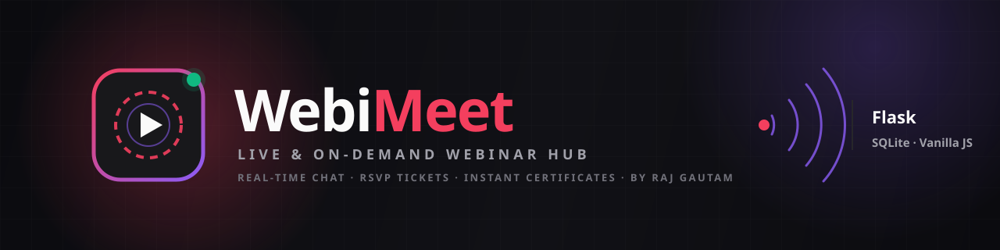
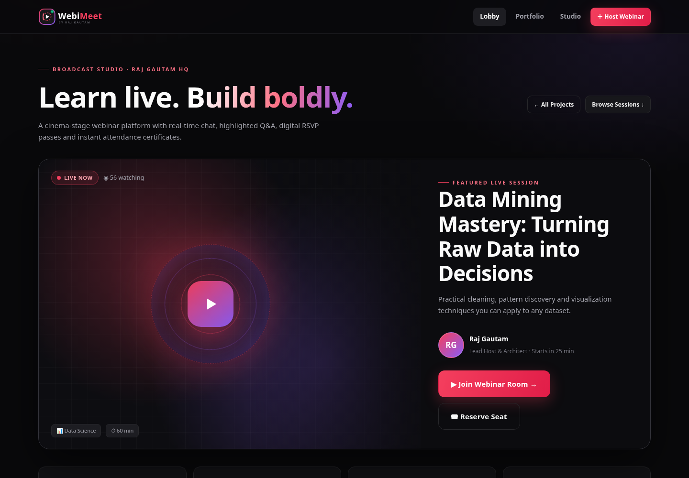
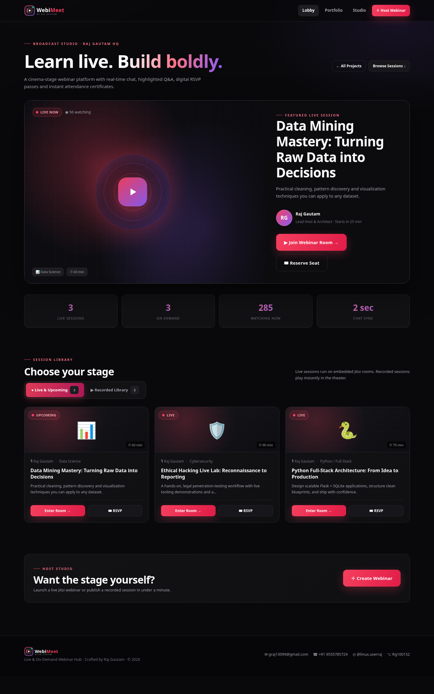
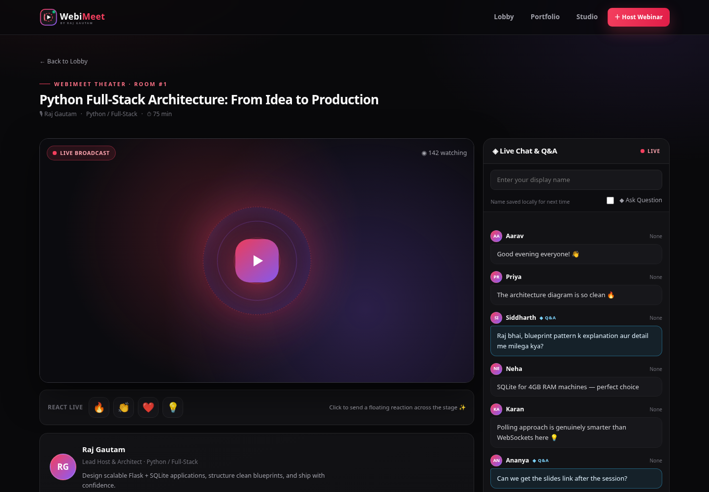
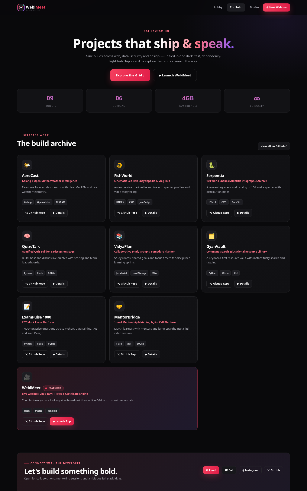
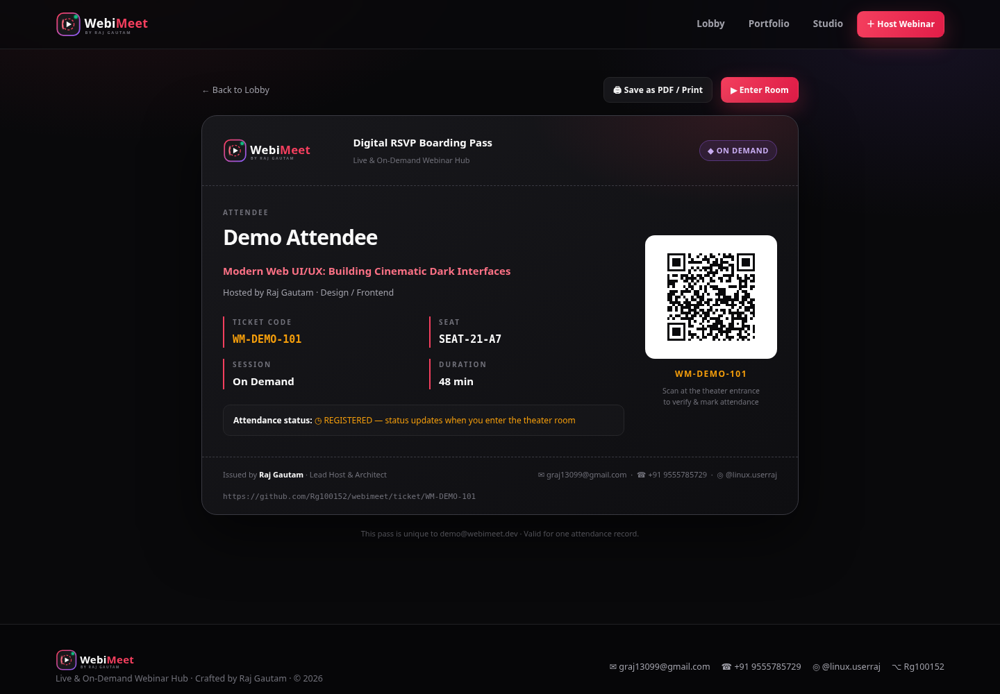
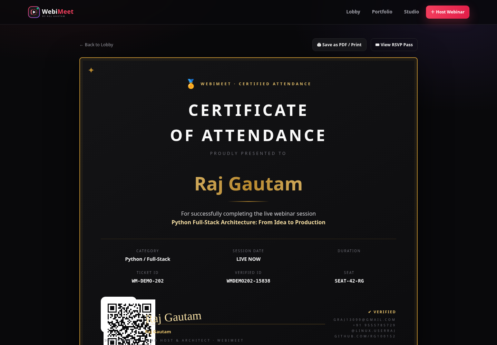
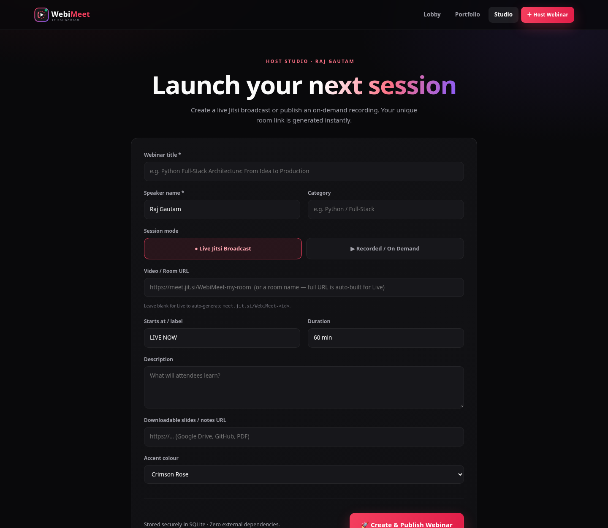
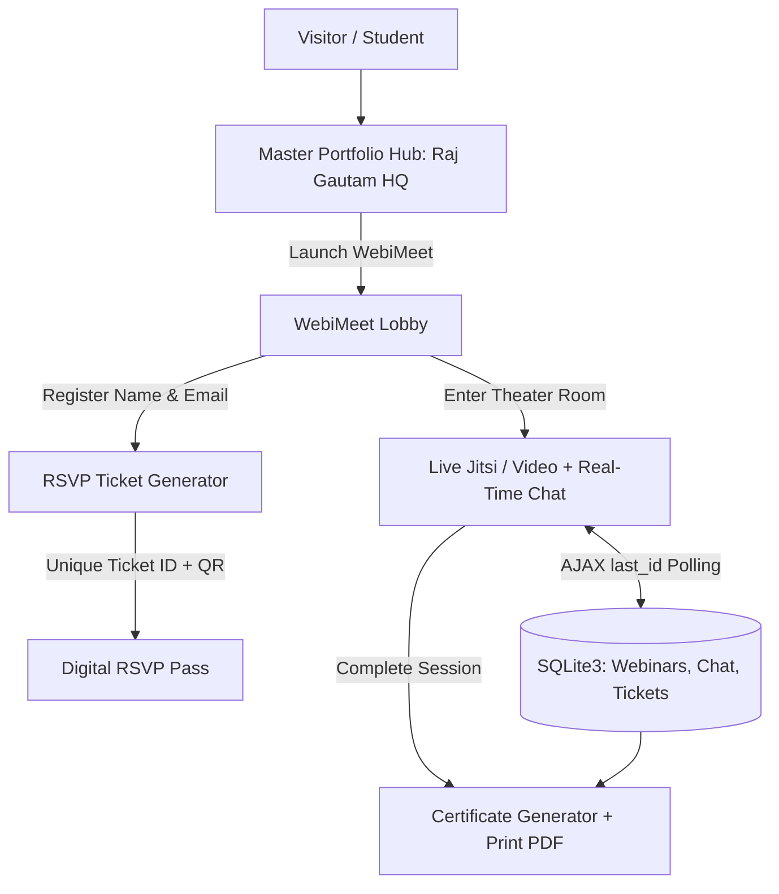
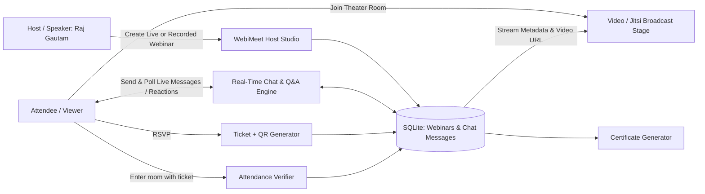

<div align="center">



<br/>


<br/><br/>


**Live & On-Demand Webinar Hub with Real-Time Chat, Q&A, Digital RSVP Passes and Instant Certificates.**

⭐ Built as a lightweight, 4GB-RAM-friendly, full-stack system — no WebSockets, no heavy PDF libraries, no external icon packs.

</div>

---

## ✨ What's Inside

| Module | What it does |
|---|---|
| 🎥 **Broadcast Theater** | 70/30 split stage — embedded Jitsi for live sessions, video embed for recordings, plus floating emoji reactions. |
| 💬 **Real-Time Chat & Q&A** | Incremental `last_id` polling every 2 seconds. Highlight important questions with one toggle. |
| 🎟️ **Digital RSVP Pass** | One-click registration → unique ticket code, seat number and a real scannable QR code. |
| 🏅 **Instant Certificate** | Attendance is verified on room entry; unlock a printable gold certificate with verification hash and digital signature. |
| 🎛️ **Host Studio** | Create a live Jitsi webinar or publish a recorded session in under a minute. |
| 🧩 **Master Portfolio Hub** | A bento-grid showcase of all 9 projects by Raj Gautam. |

---

## 🖼️ Screenshots

### Webinar Discovery Lobby
<div align="center">
  
  <br/><br/>
  
</div>

### Interactive Theater Room — 70/30 Stage + Live Chat
<div align="center">
  
</div>

### Master Developer Portfolio Hub
<div align="center">
  
</div>

### Digital RSVP Boarding Pass
<div align="center">
  
</div>

### Verified Attendance Certificate
<div align="center">
  
</div>

### Host Webinar Studio
<div align="center">
  
</div>

---

## 🏗️ System Architecture & Data Flow (DFD)



<details>
<summary><b>Detailed component-level flow</b></summary>



</details>

---

## 🔁 Real End-to-End Workflow

```text
[Stage 1: Discovery]
  Visitor lands on Raj Gautam's hub → opens WebiMeet → sees Live & Recorded webinars
                                  ▼
[Stage 2: 1-Click RSVP]
  Name + Email → unique code (WM-2026-849) + QR → /ticket/WM-2026-849
                                  ▼
[Stage 3: Live Theater]
  /room/1?ticket=WM-2026-849 → Jitsi / recorded video → chat, Q&A, floating reactions
                                  ▼
[Stage 4: Verification & Certificate]
  Ticket status flips REGISTERED → ATTENDED → /certificate/WM-2026-849 unlocks
```

---

## 🚀 Key Features

- **Dual Broadcast Modes** — Live interactive webinars via embedded Jitsi Meet and recorded on-demand video sessions.
- **Smart Incremental Chat** — `GET /api/chat/<id>?after_id=<last_id>` fetches only new messages. Tiny payloads, no page reload, no WebSocket server.
- **Q&A Highlight** — Attendees toggle "Ask Question"; speakers see a highlighted blue question badge in the chat dock.
- **Floating Emoji Reactions** — `🔥 👏 ❤️ 💡` animate upward across the video stage and sync to all viewers through the same poll.
- **Ticket-Linked Attendance** — No fake certificates. A certificate is only generated after the ticket is verified on room entry.
- **Real QR Codes** — Generated in-process by a tiny self-contained Python encoder (`qrcode.py`), rendered as crisp SVG.
- **Print-to-PDF** — Browser `@media print` rules produce high-resolution ticket and certificate PDFs — zero PDF libraries.
- **4GB RAM Friendly** — Flask + SQLite + Vanilla JS only.

---

## ⚡ Quick Start

```bash
git clone https://github.com/Rg100152/webimeet.git
cd webimeet

python3 -m venv venv
source venv/bin/activate          # Windows: venv\Scripts\activate

pip install -r requirements.txt
python seed_webinars.py
python app.py
```

Open **http://127.0.0.1:5000**

### Demo tickets

| Ticket | URL | State |
|---|---|---|
| `WM-DEMO-101` | `/ticket/WM-DEMO-101` | REGISTERED |
| `WM-DEMO-202` | `/ticket/WM-DEMO-202` | ATTENDED → certificate unlocked |

> Tip: register a new seat from the lobby, open its ticket, then click **Enter Room** — your status flips to ATTENDED and the certificate unlocks automatically.

---

## 📁 Project Structure

```text
webimeet/
├── app.py                      # Flask app, config, blueprint registration, portfolio data
├── db.py                       # Shared SQLite connection + schema helper
├── qrcode.py                   # Self-contained QR encoder (byte mode, EC-M) → SVG
├── seed_webinars.py            # 6 webinars, sample chat, reactions, demo RSVPs
├── requirements.txt            # Flask only
├── README.md                   # This file
├── .gitignore
├── database/
│   └── webimeet.db             # SQLite: webinars, chat_messages, registrations, reactions
├── routes/
│   ├── webinar_routes.py       # Lobby, room, host studio, RSVP, ticket, certificate, portfolio
│   └── api_routes.py           # JSON APIs for chat, reactions, attendance, stats
├── templates/
│   ├── base.html               # Broadcast navbar + footer with developer contact
│   ├── index.html              # Lobby: LIVE hero + tabs + session grids + RSVP modal
│   ├── room.html               # 70/30 theater + chat dock + reaction bar
│   ├── host.html               # Host Webinar Studio form
│   ├── portfolio.html          # Master hub: 9 projects in a bento grid
│   ├── ticket.html             # Printable digital RSVP pass
│   ├── certificate.html        # Printable signed certificate
│   └── 404.html
├── static/
│   ├── css/webimeet.css        # Dark theater theme + print rules
│   ├── js/liveChat.js          # 2s incremental polling, Q&A, auto-scroll
│   ├── js/reactions.js         # Floating emoji engine
│   └── assets/
│       ├── logo-webimeet.svg   # Custom broadcast play-wave logo
│       ├── webimeet-logo.png   # High-res PNG logo
│       ├── banner-webimeet.svg
│       └── webimeet-banner.png
└── screenshots/                # Real captures of every screen shown above
```
Create a new branch for this commit and start a pull request
---

## 🔌 API Reference

| Method | Endpoint | Description |
|---|---|---|
| `GET` | `/api/chat/<id>?after_id=<n>` | New messages + reactions after id `n` |
| `POST` | `/api/chat/<id>` | Post `{name, message, is_question}` |
| `POST` | `/api/reactions/<id>` | Post `{emoji}` |
| `POST` | `/api/attend` | Verify `{ticket_code}` → mark ATTENDED |
| `GET` | `/api/stats` | Platform counters |
| `GET` | `/health` | Health check |

---

## 👤 Connect with the Developer

> **Raj Gautam** — Lead Host & Architect

- ✉️ **Email:** graj13099@gmail.com
- ☎️ **Contact:** +91 9555785729
- 📸 **Instagram:** [@linux.userraj](https://instagram.com/linux.userraj)
- 🐙 **GitHub:** [github.com/Rg100152](https://github.com/Rg100152)

---

<div align="center">
  <sub>WebiMeet · Built with Flask, SQLite & Vanilla JS · © Raj Gautam</sub>
  <br/><br/>
  
</div>
